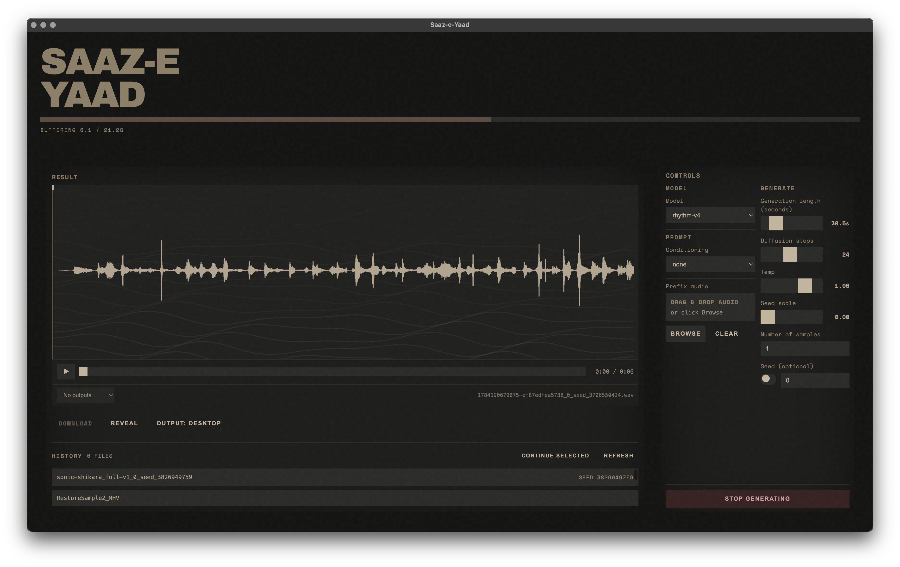

# SAAZ-E-YAAD



An autoregressive music generation system based on Continuous Autoregressive Models
(CAM) with CLAP conditioning, operating over `music2latent` audio latents. The
repository includes the training and inference pipeline plus an Electron desktop
application for interactive generation.
The models also run inside a DAW as a VST3 / AU / Standalone plugin for macOS
(see below).

**Download:** [Saz-e-yaad v1](https://www.dropbox.com/scl/fi/6kqq0tig5o70hnw5xjqcf/SONIC-SHIKARA-0.1.0-arm64.dmg?rlkey=2tbeznd3kkk51w2270xi6n1ej&st=c5kxvtpe&dl=0) (macOS Apple Silicon)

## Background

### Project Origin

Saaz-e-yaad was developed during an Open Culture Tech Artist Residency with Lacuna, **hexorcismos**, and AIxDESIGN. Over the course of one year, we explored how to develop audio generative tools based on the melodies, rhythms, and composition of Kashmiri folk music. The project involved sourcing archives of Kashmiri folk music, training 22 audio generation models, and developing a standalone desktop application.

### Dataset Provenance

The training data was sourced from several Kashmiri folk music archives:

- **Ravimech Studio (YouTube)**: ~1,000 most recently uploaded tracks from recordings made in Srinagar in the early 1980s. Permissions were obtained through family network connections.
- **DD Kashir recordings**: Archived broadcasts from Facebook
- **Family cassette collections**: Personal recordings from extended family networks

The dataset was curated and subset for specific fine-tuning tasks: harmony, melody, and rhythm.

### Method

Implementation of:

> *Continuous Autoregressive Models with Noise Augmentation Avoid Error Accumulation*
> Pasini, Nistal, Lattner, Fazekas — NeurIPS 2024 Audio Imagination Workshop
> [arXiv:2411.18447](https://arxiv.org/abs/2411.18447)

The model is an autoregressive Transformer backbone paired with a small per-frame
sampler MLP that performs a diffusion-style denoising loop. Training injects noise
into the latent context so the model is robust to its own prediction drift at
inference time. Conditioning is supplied as a sequence of CLAP tokens (from audio
or text) consumed via cross-attention.

### Model Architecture

- **Music2Latent** (audio encoding): ~200 million parameters
  - https://github.com/SonyCSLParis/music2latent/
- **Custom Continuous Autoregressive Model** (Rectified Flow + Transformer Backbone): ~180 million parameters

## Repository layout

```
.
├── preprocess.py      # Encode audio into music2latent + CLAP tokens (.pt files)
├── train.py           # Train the CAM model (CFG dropout, EMA, AMP, warmup+cosine)
├── generate.py        # Inference with CFG, optional audio/text conditioning and prefix
├── export.py          # Export a trained checkpoint to a TorchScript module
├── generate-ts.py     # Run inference directly from an exported TorchScript model
└── requirements.txt
```

The Python scripts are self-contained — model code lives inside `train.py` and is
loaded by `generate.py` / `export.py` from the saved checkpoint.

## Requirements

- Python 3.10+
- PyTorch 2.2+ (CUDA, MPS or CPU)
- `music2latent` (from source)
- See `requirements.txt` for the full list

Install in a fresh environment:

```bash
conda create -n cam python=3.10 -y
conda activate cam
pip install -r requirements.txt
```

## Pipeline

### 1. Preprocess

Encode a directory of audio files into per-track `.pt` files containing
`music2latent` frames and CLAP tokens:

```bash
python preprocess.py \
  --audio_dir /path/to/audio \
  --output_dir preprocessed \
  --sample_rate 44100 \
  --clap_window_seconds 5.0 \
  --clap_hop_seconds 5.0
```

### 2. Train

```bash
python train.py \
  --preprocessed_dir preprocessed \
  --checkpoint_dir checkpoints \
  --batch_size 32 \
  --lr 1e-4 \
  --warmup_steps 4000
```

Training uses AdamW with linear warmup followed by cosine decay, EMA weights,
mixed precision (with MPS-safe fallback), classifier-free guidance dropout, and
periodic validation samples.

### 3. Generate

```bash
python generate.py \
  --checkpoint checkpoints/checkpoint_50000.pt \
  --output_dir samples \
  --num_samples 4 \
  --gen_seconds 30 \
  --cfg_scale 5.0 \
  --temperature 1.0 \
  --diffusion_steps 24
```

Supports three conditioning modes: unconditional, text prompt, or audio prompt
(multi-token CLAP). An optional prefix audio file can seed the first N latent
frames for continuation.

### 4. Export to TorchScript

```bash
python export.py \
  --checkpoint checkpoints/checkpoint_50000.pt \
  --output ts-models/model.ts
```

The exported `.ts` file is what the Electron app loads at runtime.

### 5. Inference from TorchScript

```bash
python generate-ts.py \
  --ts_model ts-models/model.ts \
  --output_dir samples
```

### GUI Features

The renderer provides a full-featured interface for interactive music generation:

- **Model Selection**: Choose from available TorchScript models bundled with the app
- **Conditioning Modes**: 
  - Text prompts for semantic guidance
  - Audio prompts for style transfer or continuation
  - Unconditional generation
- **Prefix Continuation**: Upload an audio file to seed the beginning of generation
- **Real-time Waveform Display**: Visualize the generated audio as it streams
- **Streaming Playback**: Listen to the generation in progress without waiting for completion
- **Parameter Controls**: Adjust CFG scale, temperature, diffusion steps, and generation length
- **Export**: Save generated audio to WAV files

The GUI is built with React and styled with modern components, providing an intuitive
workflow for experimenting with different conditioning strategies and model configurations.

## Plugin (VST3 / AU / Standalone)

A JUCE port of the Electron app for use in a DAW (Ableton Live, Logic Pro, FL
Studio, Bitwig, REAPER, ...). The interface, its behaviour and the backend
protocol are the same; audio plays through the host, and renders can be dragged
from the waveform or the History list straight onto a track (or into Finder).
The (?) page credits the collaboration: AIxDESIGN x Lacuna x SEMILLA.AI Studio.

- macOS 12 or later, on Apple silicon and Intel (universal binaries).
- Offline: the frozen backend, the six models and the CLAP conditioning model
  ship with the plugin; nothing is downloaded at run time.
- Generation uses a KV-cached re-export of the TorchScript models (same weights,
  about 7x faster on CPU). On Apple silicon the sampler runs on the CPU's matrix
  units (Accelerate; stepping one frame at a time it is 4x faster there than on
  MPS) and the decoder on the GPU (Metal), about 3x faster end to end than CPU
  only. Intel Macs run everything on the CPU.
- One installer (`.pkg`) with a checkbox per format (Standalone, VST3, AU),
  pre-ticked for the DAWs it finds; the engine and models are installed once and
  shared by every format.

## License

Code is provided as-is for research use. See the original paper for the method.
